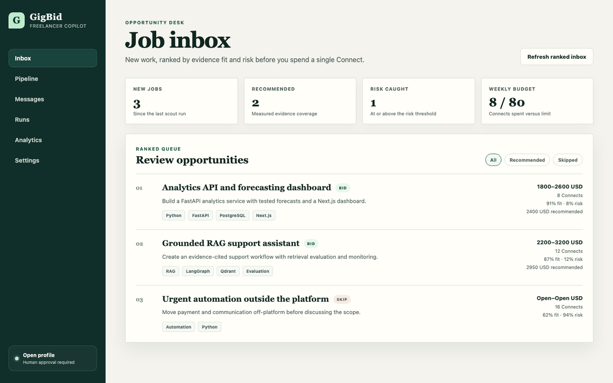
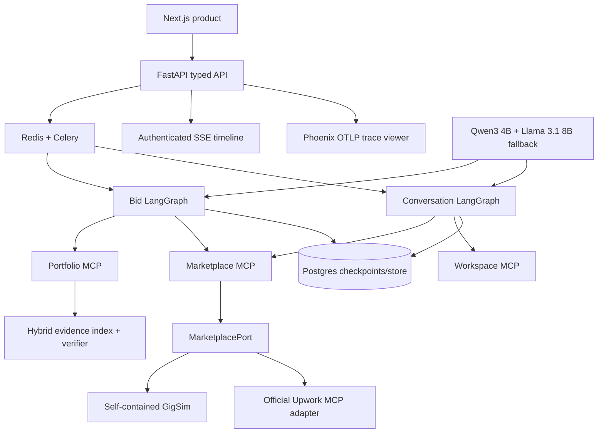

# GigBid

GigBid is a human-controlled multi-agent freelancer copilot. It discovers marketplace jobs,
evaluates risk and fit, retrieves verifiable portfolio evidence, recommends a price, drafts a
grounded proposal, and pauses for explicit approval before any external action.

This repository is an independent implementation of the AI-4016 assignment. The supplied starter
kit was used only to understand expected paths and interfaces; no placeholder implementation is
treated as a solution.



The walkthrough is captured from the real production build with clearly synthetic demo API fixtures;
it shows ranked opportunities, the durable run/approval gate, cited proposal studio, and measured
analytics without exposing private data.

## Current status

The end-to-end product slice, MCP services, durable graphs, synthetic/public-data experiments,
observability and worker reliability controls are implemented and tested. The reviewer deployment is
live on Render with GigSim as its authoritative marketplace; live Upwork access is not required.
Missing instructor assets and human calibration labels remain explicitly external. See
[`docs/IMPLEMENTATION_PLAN.md`](docs/IMPLEMENTATION_PLAN.md) and
[`docs/PHASE_STATUS.md`](docs/PHASE_STATUS.md).

## Submission evidence

| Artifact | Location / status |
| --- | --- |
| Engineering report | [`output/pdf/GigBid_AI-4016_RnD_Report.pdf`](output/pdf/GigBid_AI-4016_RnD_Report.pdf), 9 pages |
| Technical write-up | [`docs/TECHNICAL_WRITEUP.md`](docs/TECHNICAL_WRITEUP.md), 1,200–1,800 words |
| Requirements and evidence | [`docs/REQUIREMENTS_MATRIX.md`](docs/REQUIREMENTS_MATRIX.md) |
| Failure taxonomy | [`docs/FAILURE_ANALYSIS.md`](docs/FAILURE_ANALYSIS.md) |
| Open-model selection | [`docs/MODEL_PROFILE_EXPERIMENT.md`](docs/MODEL_PROFILE_EXPERIMENT.md) |
| Graphs rendered from code | [`docs/GRAPH_RENDERS.md`](docs/GRAPH_RENDERS.md) |
| Reproduction/runbook | [`docs/RUNBOOK.md`](docs/RUNBOOK.md) |
| Human/live submission work | [`docs/SUBMISSION_CHECKLIST.md`](docs/SUBMISSION_CHECKLIST.md) |
| Render deployment | [`render.yaml`](render.yaml) and [`docs/RENDER_DEPLOYMENT.md`](docs/RENDER_DEPLOYMENT.md) |
| Public reviewer app | [gigbid-web.onrender.com](https://gigbid-web.onrender.com) |
| Public API health | [gigbid-api.onrender.com/health](https://gigbid-api.onrender.com/health) |
| Video and external trace links | Remain student/account work; no placeholder is presented as evidence |

## Architecture



The graph can reason, but it cannot write directly. Every marketplace/workspace effect crosses an MCP
server, requires a typed dry-run payload and idempotency key, and is preceded by a durable human
interrupt. See [`docs/ARCHITECTURE.md`](docs/ARCHITECTURE.md) for state and trust boundaries.

## Product surface

- Persisted onboarding for persona, price floors, Connects budgets and saved searches.
- Ranked job inbox with fit, risk, action, price, evidence gaps and budget impact.
- Live checkpoint timeline, authenticated SSE, history and read-only replay.
- Proposal studio with evidence hover cards, Critic metrics, paragraph regeneration and
  approve/edit/reject controls.
- Tenant-scoped PDF/Markdown/text portfolio upload and incremental indexing.
- Pipeline, conversations, analytics and settings backed by typed APIs rather than static screens.

## Quick start

Prerequisites are Docker Desktop (or compatible Compose), at least 16 GB RAM for the default local
models, and free ports 3000, 6006, 8000, 8081, 8101–8103, 5432, 6379, 6333 and 11434.

```bash
cp .env.example .env
docker compose --env-file .env -f infra/docker-compose.yml up --build
```

Open `http://localhost:3000`. The first Compose run downloads Qwen3 4B and Llama 3.1 8B and can take
several minutes. Qwen3 4B is the measured primary writer; Llama is the configured model fallback. For
a lighter development run, select the all-4B `open_small` profile in configuration.
The local simulator is on port 8081; the owned MCP services use ports 8101–8103 and the local Phoenix
trace viewer is at `http://localhost:6006`.

For host-based development:

```bash
python -m venv .venv
source .venv/bin/activate
python -m pip install -e ".[dev]"
corepack enable
cd apps/web && pnpm install --frozen-lockfile && cd ../..
make simulator
```

Run the API, worker, beat and web commands from separate terminals as described in
[`docs/RUNBOOK.md`](docs/RUNBOOK.md). Do not reuse `.env.example` secrets outside local development.

## Render deployment

The root [`render.yaml`](render.yaml) creates a free reviewer profile: a Next.js web service, a
combined FastAPI + localhost-only GigSim service, and Postgres. It deliberately uses deterministic
model execution and synchronous graph runs so the demonstration needs no GPU, Redis, Celery, Qdrant,
or Upwork account. The complete local stack still exercises those production components. The live
reviewer is [https://gigbid-web.onrender.com](https://gigbid-web.onrender.com); deployment identifiers
and the verified hosted run are recorded in [`docs/DEPLOYMENT_EVIDENCE.md`](docs/DEPLOYMENT_EVIDENCE.md).
Follow [`docs/RENDER_DEPLOYMENT.md`](docs/RENDER_DEPLOYMENT.md) for deployment and verification.

## Safety invariants

- Job posts and client messages are untrusted data.
- Portfolio claims require cited evidence.
- No proposal, message, or Connects spend occurs without an approval interrupt.
- The assignment demonstration uses GigSim; the optional live marketplace adapter accepts only the
  official Upwork MCP route and is disabled in the Render profile.
- Every write has an idempotency key and an audit event.

## Measured engineering decisions

### MCP tool design — 40 known-call tasks, one local model

| Design | Tool accuracy | Exact argument accuracy | Tokens/task | p95 latency ms |
| --- | ---: | ---: | ---: | ---: |
| Fine-grained (shipped) | 1.00 | 0.60 | 1229.6 | 5485 |
| Coarse | 0.80 | 0.15 | 411.0 | 6061 |
| Rewritten descriptions | 1.00 | 0.50 | 1424.0 | 7740 |

### Retrieval — 90 authored synthetic jobs

| Variant | Recall@5 | nDCG@10 | Unsupported after | Reply rate | RAG p95 ms | USD/proposal |
| --- | ---: | ---: | ---: | ---: | ---: | ---: |
| V0 dense | 0.494 | 0.738 | 0 | N/A | 2.5 | 0.00 local |
| V1 requirement decomposition | 0.378 | 0.662 | 0 | N/A | 17.0 | 0.00 local |
| V2 hybrid (shipped) | 0.500 | 0.801 | 0 | N/A | 120.4 | 0.00 local |
| V3 reranked | 0.498 | 0.749 | 0 | N/A | 120.4 | 0.00 local |
| V8 corrective | 0.378 | 0.662 | 0 | N/A | 17.1 | 0.00 local |

The retrieval hypothesis failed: lexical-only ablation beat type-diverse hybrid RRF (0.833 vs 0.801
nDCG@10). V2 ships for maximum Recall@5, semantic paraphrase robustness, and evidence-type diversity,
not because fusion won. All automatic proposal,
simulator and Portfolio Builder results are synthetic; the prepared blind-panel and judge-calibration
packets remain unscored until humans complete them. Reply rate is deliberately N/A per retrieval variant:
the committed fixed simulator outcome study did not randomize RAG variants, so attaching its aggregate
reply rate to each row would invent causality.

### Open writer profile — 9 fixed synthetic jobs per model

| Model | Valid JSON | Citation precision | Unsupported after | Personalization | p95 latency | Local USD |
| --- | ---: | ---: | ---: | ---: | ---: | ---: |
| Qwen3 4B Q4_K_M (shipped) | 1.00 | 1.00 | 0.00 | 0.630 | 11.4 s | 0.00 |
| Llama 3.1 8B Q4_K_M (fallback) | 1.00 | 1.00 | 0.00 | 0.556 | 33.5 s | 0.00 |

The fixed-temperature, fixed-seed run used identical V2 evidence on an Apple M4. Raw outputs, exact
digests, token/latency rows, the selection rule, and the synthetic-data limitation are in
[`docs/MODEL_PROFILE_EXPERIMENT.md`](docs/MODEL_PROFILE_EXPERIMENT.md).

### Agent control design — 50 public jobs, deterministic read-only baseline

| Control policy | Completion | Injection recall | Mean control steps | p95 ms | External writes | GigSim outcome |
| --- | ---: | ---: | ---: | ---: | ---: | --- |
| Hand-built graph (shipped) | 1.00 | 1.00 | 4 | 7.19 | 0 | Not measured |
| Supervisor-style | 1.00 | 1.00 | 8 | 7.22 | 0 | Not measured |
| ReAct-style | 1.00 | 1.00 | 8 | 7.15 | 0 | Not measured |

The three policies shared deterministic analysis nodes, so this table supports the lower-control-step
choice only. A separate frozen six-job GigSim slice executes every policy through both pinned models:

| Model | Policy | Controller completion | Final F1 | Final safety violations | Tokens in/out | p95 latency |
| --- | --- | ---: | ---: | ---: | ---: | ---: |
| Qwen3 4B | Hand / supervisor / ReAct | 0.833 / 1.000 / 0.833 | 1.00 each | 0 each | 3,556/1,257 · 2,938/409 · 3,658/1,669 | 30.0 / 4.1 / 19.0 s |
| Llama 3.1 8B | Hand / supervisor / ReAct | 1.000 each | 1.00 each | 0 each | 2,620/217 · 2,884/326 · 3,076/1,121 | 4.2 / 7.5 / 16.3 s |

The deterministic fallback retained correct safe actions when Qwen twice failed the controller
schema; raw invalid outputs and token costs are preserved. ReAct was the most token- and latency-heavy
policy for both models. See
[`docs/AGENT_MODEL_DESIGN_EXPERIMENT.md`](docs/AGENT_MODEL_DESIGN_EXPERIMENT.md); its reply/hire rates
are explicitly deterministic simulator outcomes, not marketplace evidence.

## Verification

```bash
make lint
make test
make eval
make eval-tools
make eval-model-profiles
make eval-agent-design
make eval-agent-model-design
make eval-portfolio-builder
docker compose --env-file .env.example -f infra/docker-compose.yml config --quiet
cd apps/web && pnpm lint && pnpm build && pnpm test:e2e
```

The latest checked product run contains 20 passing Playwright cases across desktop and mobile. The
Postgres restart test is optional when Docker is unavailable and runs in CI with the service present.

## Local development

1. Copy `.env.example` to `.env` and replace development secrets.
2. Install Python 3.11+ dependencies with `python -m pip install -e ".[dev]"`.
3. Install the web dependencies with `pnpm --dir apps/web install`.
4. Run `make test` for the deterministic test suite.
5. Run `make dev` when Docker services are configured.

## Public research data

Run `make data` to download the three selected, version-pinned Kaggle archives, verify their SHA-256
checksums, and create redacted normalized JSONL under `data/processed/kaggle/`. Raw and processed
records are intentionally ignored by Git; the source registry, licenses, transformations and actual
row counts remain reproducible in `data/sources.yaml`, `docs/DATA_CARD.md` and the generated
`data/processed/kaggle/manifest.json`.

`make public-profile` regenerates the committed descriptive market profile and compact pricing priors
from the normalized local records. The pricing node records the category, sample size and public
source whenever it uses one; user floors and explicit client budget bands always take precedence.

The committed smoke evaluation is for plumbing verification only. It is not used as reportable R&D
evidence. Public Kaggle jobs can support job, risk and pricing studies, but grounded proposal/RAG
experiments still require a separately labelled portfolio corpus and human judgements.

Run `make eval` to regenerate the smoke check, 90-job synthetic RAG benchmark, component ablation and
fixed simulator outcome study. The generator creates three explicitly synthetic personas with 15 case
studies and 150 past proposals each. The
preregistered hypothesis, full results and limitations are recorded in
[`docs/RAG_EXPERIMENT.md`](docs/RAG_EXPERIMENT.md); these results validate plumbing and are not real
freelancer or GigSim outcomes.

`make eval-human-prep` creates 30 blinded proposal pairs and a separate 30-item judge-calibration
worksheet. They deliberately remain unscored until humans provide ratings; see
[`docs/HUMAN_EVALUATION.md`](docs/HUMAN_EVALUATION.md).

`make eval-tools` runs the separate 40-task tool-granularity study against a local Ollama model. The
committed zero-error run and the decision to ship single-purpose tools are documented in
[`docs/TOOL_DESIGN_EXPERIMENT.md`](docs/TOOL_DESIGN_EXPERIMENT.md).

`make eval-model-profiles` compares the pinned Qwen3 4B and Llama 3.1 8B writer profiles on the same
fixed synthetic development slice. It requires both models to be present in local Ollama.

`make eval-agent-design` regenerates the read-only 50-job control-policy baseline. Its strict
limitations and the decision to retain the hand-built graph are in
[`docs/AGENT_DESIGN_EXPERIMENT.md`](docs/AGENT_DESIGN_EXPERIMENT.md).

`make eval-agent-model-design` runs the separate frozen two-model hand-built/supervisor/ReAct study,
including bounded retries, raw invalid responses, tokens, latency, safety fallback and synthetic
GigSim outcomes. It requires both pinned models in local Ollama.

`make simulator` starts the self-contained GigSim-compatible service generated from approved public
jobs and explicitly synthetic client behaviour. `make eval-simulator-outcomes` regenerates the fixed
30-job-per-persona decision, safety, pricing, grounding and outcome study. Provenance, results and
limitations are documented in [`docs/SIMULATOR_EXPERIMENT.md`](docs/SIMULATOR_EXPERIMENT.md).

Never commit `.env`, OAuth tokens, real client data, or hidden evaluation data.

