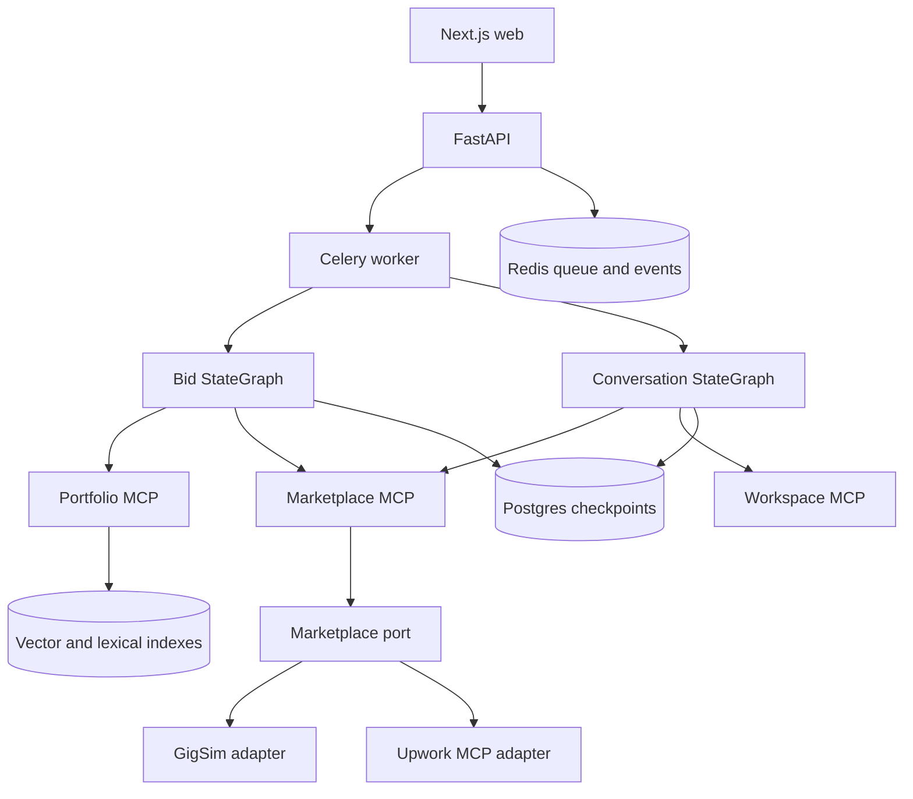

# Architecture

GigBid separates marketplace effects, agent reasoning, retrieval, persistence, and presentation.

## Boundaries

- Agents receive only allowlisted MCP tools.
- MCP tools are discovered through LangChain's maintained `langchain.mcp` adapter and are prefixed by
  server name before allowlisting.
- Marketplace-specific behavior exists only in adapters behind `MarketplacePort`.
- Graph state contains current work; traces contain execution history; long-term stores contain only
  explicitly promoted style and outcome memories.
- Every external write is previewed, interrupted for approval, rechecked, and executed once using an
  idempotency key.

## Bid graph

The Job Analyst, Risk Assessor, and Fit Matcher fan out after scouting. Their typed reports join at a
decision node. Bid candidates continue through pricing, writing, claim verification, a bounded Critic
loop, compliance, and approval. Skip and attention decisions terminate without marketplace effects.
The exact compiled graph render is generated in [`GRAPH_RENDERS.md`](GRAPH_RENDERS.md), not redrawn
from memory.

## Conversation graph

Client messages are classified as questions, negotiation, interview requests, or risk signals. Safe
messages produce a cited response or tentative interview choices and then pause for approval.
Its exact compiled render is generated beside the bid graph in
[`GRAPH_RENDERS.md`](GRAPH_RENDERS.md).

